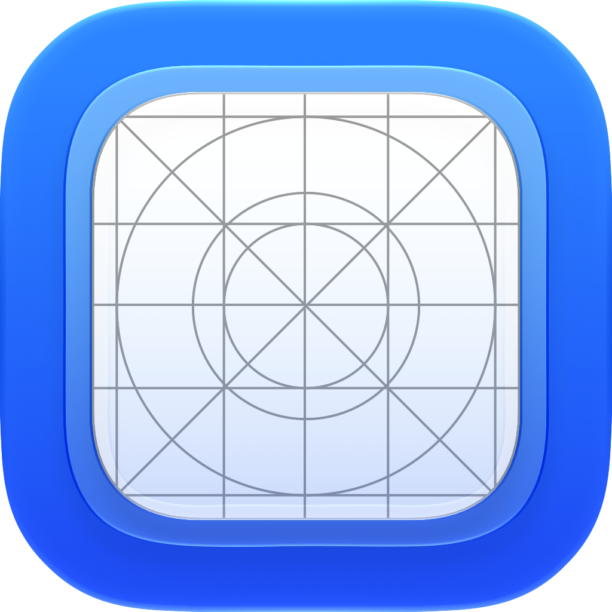

<div align="center">
   
</div>
   

<div align="center">
  <h1><b>LiveContainer</b></h1>
  <p><i>An app launcher that runs iOS apps without actually installing them! </i></p>
</div>
<h6 align="center">

Crowdin Project: [](https://crowdin.com/project/livecontainer) &nbsp;| &nbsp; Documentation:[livecontainer.github.io](https://livecontainer.github.io/docs/intro)

# LiveContainer

- LiveContainer is an app launcher (not emulator or hypervisor) that allows you to run iOS apps inside it.
- Allows you to install unlimited apps (3 app/10 app id free developer account limit does not apply here) with only one app & app id. You can also have multiple versions of an app installed with multiple data containers.
- (Below iOS 26) When JIT is available, codesign is entirely bypassed, no need to sign your apps before installing. Otherwise, your app will be signed with the same certificate used by LiveContainer.

> [!CAUTION]
> **Important Notice Regarding Third-Party Builds of LiveContainer**
>
> We have recently noticed the appearance of certain closed-source third-party builds of LiveContainer. Please be aware that all your apps are installed within LiveContainer, which means these third-party builds **have full access to your data, including sensitive information such as keychain items and login credentials**. 
> 
> Furthermore, please note that we do not provide any support for issues of these third-party builds.


# MCP / HTTP remote control (`remote-control` branch)

> **LiveContainer is an open-source project**: upstream is [LiveContainer/LiveContainer](https://github.com/LiveContainer/LiveContainer), licensed **AGPL-3.0**. This branch only adds a remote-control layer on top (HTTP API + MCP bridge); every change is released under the same AGPL-3.0, and this fork is not affiliated with upstream.

A bearer-authenticated HTTP server runs inside the app and exposes IPA install, app launch, multitask windows, UI taps, screenshots, tweak management and logs; a dependency-free MCP bridge lets agents such as Claude or Hermes drive the device.

```
MCP client (Claude / Hermes / ...) --stdio--> tools/mcp/lc_mcp.py --HTTP + Bearer--> device :8848 (inside LiveContainer)
```

> No third-party libraries on device; the MCP bridge is a single Python file (standard library only). Full reference: [docs/MCP.md](docs/MCP.md)
>
> Guest apps run in their own process (LiveProcess), so a second server listens on `127.0.0.1:8850` inside it and the host proxies `/api/v1/guest/*` to it. That is what makes it possible to tap buttons **inside** the guest app and capture its own screen.

## Quick start

1. Sideload the IPA built from this branch (unsigned; sign it with your own certificate). **Keep App Extensions when installing**, otherwise launching an app fails with `LiveProcess extension not found`.
2. In the app: **Settings -> Remote Control** -> enable "Enable HTTP server" (default port 8848, "Silent audio" keep-alive recommended) and copy the **token**.
3. Register the MCP bridge on the PC:

```json
{
  "mcpServers": {
    "livecontainer": {
      "command": "python3",
      "args": ["/path/to/tools/mcp/lc_mcp.py"],
      "env": {
        "LC_REMOTE_URL": "http://<device-ip>:8848",
        "LC_REMOTE_TOKEN": "<token from the settings page>"
      }
    }
  }
}
```

## MCP tools (40)

The remote-control API is also exposed as MCP tools through a single-file Python bridge
([tools/mcp/lc_mcp.py](tools/mcp/lc_mcp.py), standard library only).

| Group | Tools |
| --- | --- |
| Device / install / launch | `lc_health` `lc_apps` `lc_install_ipa` `lc_install_from_url` `lc_jobs` `lc_uninstall_app` `lc_launch_app` `lc_open_app` (= list then open) `lc_close_app` `lc_window_chrome` `lc_window_press` |
| Tweaks (dylib / framework) | `lc_tweaks` `lc_tweak_import` `lc_tweak_toggle` `lc_tweak_sign` `lc_tweak_delete` `lc_tweak_folder` |
| Multitask windows | `lc_windows` `lc_window_action` (scale / pip / maximize / close) |
| UI automation (container) | `lc_ui_tree` `lc_ui_activate` `lc_ui_tap` `lc_ui_taps` (tap sequence) `lc_ui_tab` `lc_ui_text` `lc_screenshot` |
| UI automation (inside the guest app) | `lc_guest_info` `lc_guest_tree` `lc_guest_activate` `lc_guest_taps` `lc_guest_text` `lc_guest_screenshot` `lc_guest_ocr` `lc_guest_ocr_history` `lc_guest_inspect` |
| Logs | `lc_logs` `lc_log_push` (container) `lc_guest_logs` `lc_guest_logs_clear` (guest app + injected tweaks) |
| Keep-alive | `lc_keepalive` (off / audio / screenAwake / audioAndScreen) |

Every tool's parameters, response shape and curl equivalent are documented in [docs/MCP.md](docs/MCP.md).

## Limitations

- The server is only reachable while LiveContainer is in the foreground, or while silent-audio keep-alive is active (iOS suspends the process otherwise).
- For debugging prefer `lc_open_app` / `lc_launch_app(..., multitask: true)`: launching without multitask hands the foreground to the guest app and the server briefly goes away.
- Tweaks are only loaded after the device re-signs them; `lc_tweak_sign` returning `changedCount=0` means the certificate is unusable (wrong p12 password or expired).
- `lc_guest_logs` covers stderr/stdout (NSLog / printf / Swift print); logs written through `os_log()` are not included.

# Installation
**LiveContainer comes with a standalone version and a version with built-in SideStore. [Please read the install guide here](https://livecontainer.github.io/docs/installation)**

If you encounter any issue please [read our FAQ here](https://livecontainer.github.io/docs/faq)

### Standalone 
<table>
<tr>
<td>
Stable
</td>
<td>
<a href="https://stikstore.app/altdirect/?url=https://github.com/LiveContainer/LiveContainer/releases/download/1.0/apps.json&exclude=livecontainer" target="_blank">
   
</a>
</td>
<td>
<a href="https://github.com/LiveContainer/LiveContainer/releases/latest/download/LiveContainer.ipa" target="_blank">
   
</a>
</td>
</tr>
<tr>
<td>
Nightly
</td>
<td>
<a href="https://stikstore.app/altdirect/?url=https://github.com/LiveContainer/LiveContainer/releases/download/nightly/apps_nightly.json&exclude=livecontainer" target="_blank">
   
</a>
</td>
<td>
<a href="https://github.com/LiveContainer/LiveContainer/releases/download/nightly/LiveContainer.ipa" target="_blank">
   
</a>
</td>
</tr>
</table>

### LiveContainer+SideStore
|Stable|Nightly|
|:-:|:-:|
|<a href="https://github.com/LiveContainer/LiveContainer/releases/latest/download/LiveContainer+SideStore.ipa" target="_blank"></a>|<a href="https://github.com/LiveContainer/LiveContainer/releases/download/nightly/LiveContainer+SideStore.ipa" target="_blank"></a>|


## Requirements

- iOS/iPadOS 15+
   + Multitasking requires iOS/iPadOS 16.0+
- AltStore 2.0+ / SideStore 0.6.0+


# Features & Guides

### Installing Apps
- Open LiveContainer, tap the plus icon in the upper right hand corner and select IPA files to install.
- Choose the app you want to open in the next launch.
- You can long-press the app to manage it.

### [Add Apps to Home Screen](https://livecontainer.github.io/docs/guides/add-to-home-screen)

### [Multiple LiveContainers](https://livecontainer.github.io/docs/guides/multiple-livecontainers)
Using multiple LiveContainers allows you to run multiples different apps simultaneously, with *almost* seamless data transfer between the LiveContainers.

### [Multitasking](https://livecontainer.github.io/docs/guides/multitask)
You can now launch multiple apps simultaneously in in-app virtual windows. These windows can be resized, scaled, and even displayed using the native Picture-in-Picture (PiP) feature. On iPads, apps can run in native window mode, displaying each app in a separate system window. And if you wish, you can choose to run apps in multitasking mode by default in settings.

To use multitasking, hold its banner and tap **"Multitask"**. You can also make Multitask the default launch mode in settings.

>[!Note]
>1. To use multitasking, ensure you select **"Keep App Extensions"** when installing via SideStore/AltStore.  
>2. If you want to enable JIT for multitasked apps, you’ll need a JIT enabler that supports attaching by PID. (StikDebug)

### [JIT Support](https://livecontainer.github.io/docs/guides/jit-support)
### [Installing external tweaks](https://livecontainer.github.io/docs/guides/tweaks)
### [Multiple Containers/External Containers](https://livecontainer.github.io/docs/guides/containers-and-external-data)
### [Hiding Apps](https://livecontainer.github.io/docs/guides/lock-app)

### Fix File Picker & Local Notification
Some apps may experience issues with their file pickers or not be able to apply for notification permission in LiveContainer. To resolve this, enable "Fix File Picker" & "Fix Local Notifications" accordingly in the app-specific settings.

### "Open In App" Support
- You can simply share a URL or a file to app simply by using iOS's native share sheet. In share sheet, select LiveContainer, and LiveContainer will ask you which app you'd like to open that URL/file in.
- What's more, you also can tap the link icon in the top-right corner of the "Apps" tab and input the URL. LiveContainer will detect the appropriate app and ask if you want to launch it.

## Compatibility
Unfortunately, not all apps work in LiveContainer, so we have a [compatibility list](https://github.com/LiveContainer/LiveContainer/labels/compatibility) to tell if there is apps that have issues. If they aren't on this list, then it's likely going run. However, if it doesn't work, please make an [issue](https://github.com/LiveContainer/LiveContainer/issues/new/choose) about it.

## Building
Download [OpenSSL xcframework](https://github.com/krzyzanowskim/OpenSSL/releases), decompress and put it in Depencencies.

Open Xcode, edit `DEVELOPMENT_TEAM[config=Debug]` in `xcconfigs/Global.xcconfig` to your team id and compile.

## Project structure
### Main executable
- Core of LiveContainer
- Contains the logic of setting up guest environment and loading guest app.
- If no app is selected, it loads LiveContainerSwiftUI.

### LiveContainerSwiftUI
- SwiftUI rewrite of LiveContainerUI (by @hugeBlack)
- Language file `Localizable.xcstrings` is in here for multilingual support. To help us translate LiveContainer, please visit [our crowdin project](https://crowdin.com/project/livecontainer)

### MultitaskSupport
- Contains the implementation of multitasking feature.
- Based on [FrontBoardAppLauncher](https://github.com/khanhduytran0/FrontBoardAppLauncher)

### SideStore
- Supporting code for SideStore's app refreshing integration

### TweakLoader
- A simple tweak injector, which loads CydiaSubstrate and loads tweaks.
- Injected to every app you install in LiveContainer.

### ZSign
- The app signer shipped with LiveContainer.
- Originally made by [zhlynn](https://github.com/zhlynn/zsign).
- LiveContainer uses [Feather's](https://github.com/khcrysalis/Feather) version of ZSign modified by khcrysalis.
- Changes are made to meet LiveContainer's needs.

## How does it work?

### Patching guest executable
- Patch `__PAGEZERO` segment:
  + Change `vmaddr` to `0xFFFFC000` (`0x100000000 - 0x4000`)
  + Change `vmsize` to `0x4000`
- Change `MH_EXECUTE` to `MH_DYLIB`.
- Inject a load command to load `TweakLoader.dylib`

### Patching `@executable_path`
- Hook `dyld4::APIs::_NSGetExecutablePath`
- Call `_NSGetExecutablePath`
- Replace `config.process.mainExecutablePath`
  - Calculate address of `config.process.mainExecutablePath` using `dyld4::APIs` instance (passed as first parameter)
  - Use `builtin_vm_protect` or TPRO unlock to make it writable
  - Replace the address with one we have control of
- Put the original `dyld4::APIs::_NSGetExecutablePath` back

> Old Method
>- Call `_NSGetExecutablePath` with an invalid buffer pointer input -> SIGSEGV
>- Do some [magic stuff](https://github.com/khanhduytran0/LiveContainer/blob/5ef1e6a/main.m#L74-L115) to overwrite the contents of executable_path.

### Patching `NSBundle.mainBundle`
- This property is overwritten with the guest app's bundle.

### Bypassing Library Validation
- JIT is optional to bypass codesigning. In JIT-less mode, all executables are signed so this does not apply.
- Derived from [Restoring Dyld Memory Loading](https://blog.xpnsec.com/restoring-dyld-memory-loading)

### dlopening the executable
- Call `dlopen` with the guest app's executable
- TweakLoader loads all tweaks in the selected folder
- Find the entry point
- Jump to the entry point
- The guest app's entry point calls `UIApplicationMain` and start up like any other iOS apps.

### Multi-Account support & Keychain Semi-Separation
[128 keychain access groups](./entitlements.xml) are created and LiveContainer allocates them randomly to each container of the same app. So you can create 128 container with different keychain access groups.

## Limitations
- Entitlements from the guest app are not applied to the host app. This isn't a big deal since sideloaded apps requires only basic entitlements.
- App Permissions are globally applied.
- Guest app containers are not sandboxed. This means one guest app can access other guest apps' data.
- App extensions aren't supported. they cannot be registered because: LiveContainer is sandboxed, SpringBoard doesn't know what apps are installed in LiveContainer, and they take up App ID.
- Multitasking can be achieved by using multiple LiveContainer and the multitasking feature. However, while we were able to fix physical keyboard input issue on iPadOS (https://github.com/LiveContainer/LiveContainer/issues/524), iPhone Mirroring uses different checks which still broke it (https://github.com/LiveContainer/LiveContainer/issues/793).
- Remote push notification will not work
- Querying custom URL schemes might not work(?)

## TODO
- Use ChOma instead of custom MachO parser

## License
[GNU Affero General Public License v3.0](https://github.com/LiveContainer/LiveContainer/blob/main/LICENSE)

## Credits
- [xpn's blogpost: Restoring Dyld Memory Loading](https://blog.xpnsec.com/restoring-dyld-memory-loading)
- [LinusHenze's CFastFind](https://github.com/pinauten/PatchfinderUtils/blob/master/Sources/CFastFind/CFastFind.c): [MIT license](https://github.com/pinauten/PatchfinderUtils/blob/master/LICENSE)
- [litehook](https://github.com/opa334/litehook): [MIT license](https://github.com/opa334/litehook/blob/main/LICENSE)
- @haxi0 & @m1337v for icon
- @Vishram1123 for the initial shortcut implementation.
- @hugeBlack for SwiftUI contribution
- @Staubgeborener for automatic AltStore/SideStore source updater
- @fkunn1326 for improved app hiding
- @slds1 for dynamic color feature
- @Vishram1123 for iOS 26+ JIT Script Support
- @StephenDev0 for AltStore source support
